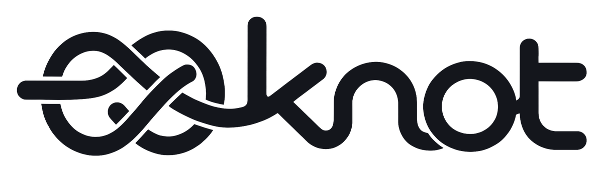
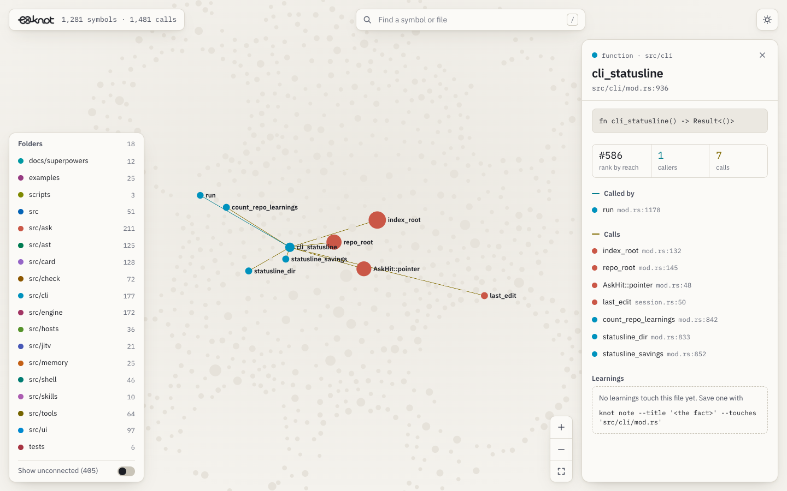

<p align="center">
  <picture>
    <source media="(prefers-color-scheme: dark)" srcset="assets/logo-light.png">
    
  </picture>
</p>

# Knot

**Code graph search and team learnings for coding agents.**

Knot indexes your repository with Tree-sitter and answers the questions agents spend most of
their tokens on: *where is the code that does X*, *every place Y appears*, *what calls Z*.
It also keeps the team's decisions next to the code: a learning committed to the repo shows
up for the next person (or agent) who opens that code, `knot check` stops a change that goes
against it, and a teammate editing the same symbol on another branch is named before either
change merges.

It runs as a CLI and as an MCP server, so it works with Claude Code, Codex, Gemini CLI,
OpenCode, Cursor, Windsurf, VS Code and any other MCP client. No LLM calls, no server, no
account: everything runs locally and learnings travel through git.

> Built in Dhaka for the global developer community.

---

## Contents

- [What it does](#what-it-does)
- [Install](#install)
- [Set up a repository](#set-up-a-repository)
- [Agent support](#agent-support)
- [Finding code](#finding-code)
- [See the code graph](#see-the-code-graph)
- [Team learnings](#team-learnings)
- [Status line](#status-line)
- [Share what Knot saved](#share-what-knot-saved)
- [Command reference](#command-reference)
- [MCP tools](#mcp-tools)
- [Languages](#languages)
- [Configuration](#configuration)
- [Where Knot keeps data](#where-knot-keeps-data)
- [How it compares](#how-it-compares)

---

## What it does

| | |
|---|---|
| **Find code** | `knot ask` ranks every symbol for a question (BM25F plus a call-graph rerank) and returns `file:line` spans with excerpts. `knot grep` finds every match, grouped by the function that contains it. `knot map` orients you in a new repo. `callers`, `callees`, `blast` and `skeleton` answer structural questions. |
| **Always current** | No build step. Every command reparses only the files that changed since the last one, and the status line re-indexes in the background when files change. |
| **Team learnings** | `knot note` saves a decision, what was ruled out and why, as a markdown file in `.knot/learnings/`. It surfaces when anyone opens that code, with who wrote it and what it took to work out. |
| **Pre-PR check** | `knot check` compares your diff with the learnings: changing a value a decision pins (`defaultRetryMax = 4` → `10`) or bringing back a ruled-out approach is a conflict until the commit message says why. |
| **Branch clashes** | When you edit a symbol a teammate is also changing on an unmerged branch, Knot says so, with both values: *Kumar raises defaultRetryMax from 4 to 10 on origin/kumar/retry; you lower it to 3.* |

---

## Install

### One-liner (macOS, Linux)

```bash
curl -fsSL https://raw.githubusercontent.com/dreygur/knot/main/install.sh | bash
```

Downloads the binary to `~/.local/bin/knot`, registers Knot as an MCP server with Claude
Code and Codex when their CLIs are installed, and prints the config to paste for every
other client.

### Windows

```powershell
./install.ps1    # from a clone; builds with cargo and registers with Claude Code / Codex
```

### Claude Code plugin

```
/plugin marketplace add dreygur/knot
/plugin install knot@knot
```

The plugin starts `knot` from your `PATH`, so install the binary first (one-liner above).

### From source

```bash
git clone https://github.com/dreygur/knot && cd knot
cargo build --release
cp target/release/knot ~/.local/bin/
```

| Platform | Release binary |
|---|---|
| Linux x86_64 | `knot-x86_64-unknown-linux-gnu` |
| macOS x86_64 | `knot-x86_64-apple-darwin` |
| macOS Apple Silicon | `knot-aarch64-apple-darwin` |
| Windows x86_64 | `knot-x86_64-pc-windows-msvc.exe` |

---

## Set up a repository

```bash
cd your-repo
knot init
```

`knot init` asks which agents you use, with the ones installed here already checked, and
writes instructions only for those:

| Agent | Writes |
|---|---|
| `claude` | `CLAUDE.md` |
| `codex`, `opencode` | `AGENTS.md` |
| `gemini` | `GEMINI.md` |
| `antigravity` | `GEMINI.md` and a skill in `~/.gemini/skills/knot/` |
| `cursor` | `.cursor/rules/knot.mdc` |

It also registers Knot's MCP server with each picked agent in that agent's user config
(the MCP column under [Agent support](#agent-support)): through `claude mcp add` and
`codex mcp add` for Claude Code and Codex, and by adding a `knot` entry to the JSON file for
the others. An existing `knot` entry is left as it is, and a config file that doesn't parse
is reported, not rewritten. If you keep OpenCode's config in `opencode.jsonc`, Knot never edits it
(that would lose its comments) and prints the entry to paste instead. Then it adds Knot to your `PATH` if it isn't there yet and indexes
the code into `.knot/cache/`. `knot init --agents claude,codex` skips the picker; `knot init --yes` takes
every agent found on this machine. The instructions sit between `<!-- knot:start -->` and
`<!-- knot:end -->` markers, so re-running `init` updates them in place and leaves the rest
of each file alone.

Commit the instruction files and `.knot/learnings/` so teammates and their agents get them.

### Python block (Claude Code, per repo)

When you pick Claude Code, `knot init` adds a `PreToolUse` Bash hook to
`.claude/settings.local.json` in this repo only, and keeps that file out of git. It stops a
python script that writes a code file the first time an agent runs it in a session and points
the agent at its edit tools; the same command run again goes through. It only ever denies, so it
runs beside any other Bash hook. `knot status` shows `python_block=on|off`.

---

## Agent support

Knot works in two layers. **Every** agent gets the MCP tools and the CLI; agents with hooks
also get learnings and clash warnings pushed to them while they work.

| Agent | MCP server | Instructions `knot init` writes | Hooks and status line |
|---|---|---|---|
| Claude Code | `claude mcp add -s user knot -- knot` (or the plugin) | `CLAUDE.md` | Yes, registered automatically on first start |
| OpenAI Codex CLI | `codex mcp add knot -- knot` | `AGENTS.md` | - |
| Gemini CLI | `~/.gemini/settings.json`: `"mcpServers": {"knot": {"command": "knot"}}` | `GEMINI.md` | - |
| OpenCode | `~/.config/opencode/opencode.json`: `"mcp": {"knot": {"type": "local", "command": ["knot"], "enabled": true}}` | `AGENTS.md` | - |
| Cursor | `~/.cursor/mcp.json`: `"mcpServers": {"knot": {"command": "knot"}}` | `.cursor/rules/knot.mdc` | - |
| Antigravity | `~/.gemini/config/mcp_config.json`: `"mcpServers": {"knot": {"command": "knot"}}` | `GEMINI.md`, `~/.gemini/skills/knot/SKILL.md` | - |
| Windsurf | `~/.codeium/windsurf/mcp_config.json`: `"mcpServers": {"knot": {"command": "knot"}}` | `AGENTS.md` if you pick `codex` or `opencode` | - |
| VS Code (Copilot) | `.vscode/mcp.json`: `"servers": {"knot": {"type": "stdio", "command": "knot"}}` | `AGENTS.md` if you pick `codex` or `opencode` | - |
| Any other MCP client | stdio server, command `knot`, no arguments | `AGENTS.md` if you pick `codex` or `opencode` | - |

Agents without hooks still see learnings through `knot ask` / `knot_ask`, and `knot check`
works anywhere you run it (including CI).

On Claude Code, Knot registers its hooks in `~/.claude/settings.json` the first time it
starts: `knot hook post-tool` after Read/Edit/Write (learnings on that file, branch clashes),
`knot hook usage` after every tool (a warning to write the handoff when the context window or
the five hour limit is nearly used up), `knot hook session-start`, and `knot hook stop` (promotes the session's verified memories). It also adds its status line
when you have none. Other tools' hooks and an existing status line are left alone.

---

## Finding code

```bash
knot map                                   # where the code lives, what is most central
knot ask "where are retries scheduled"     # ranked symbols with file:line and excerpts
knot ask "..." --source                    # include each hit's code
knot grep "defaultRetryMax"                # every match, grouped by enclosing symbol
knot grep -F "send(" --in src/net          # literal text, limited to a path
knot callers Client.Do                     # direct callers and importing files
knot blast parse_request --depth 3         # everything that transitively depends on it
knot skeleton client.go                    # a file's signatures with line spans
```

`knot map` collapses wrapper directories (`src/` that only holds `src/requests/`), splits a
directory that holds most of the repo, lists each cluster's most called symbols, and ranks
the most central non-test code by PageRank.

```
repo map: 36 files · 753 symbols · 1034 edges · Python 36

tests/               13 files ·   448 symbols
src/requests/        18 files ·   284 symbols   hubs: PreparedRequest.prepare (models.py, 36←), Request.prepare (models.py, 35←), ...

most central code (PageRank, tests excluded):
  Session · class · src/requests/sessions.py:L356-L816 · 55 caller(s)
  ...
```

Commands work from any subdirectory: they use the root of the git repository you are in,
while file arguments (`skeleton graph.rs`, `grep --in .`) are read relative to where you are.
TypeScript path aliases from `tsconfig.json` / `jsconfig.json` (`@/lib/...`) resolve to the
right files, so calls and imports through them are part of the graph.

Every command takes `--json` where it makes sense, for scripts and other tools.

---

## See the code graph

`knot viz` writes the repo's call graph to `.knot/cache/graph.html` and opens it. Each folder
settles into its own region, and a symbol's size shows how central it is. Click one to see its
callers, its calls and the learnings on its file; `/` searches by name or file.

<picture>
  <source media="(prefers-color-scheme: dark)" srcset="assets/screenshots/knot-viz-dark.png">
  
</picture>

The page is one offline file: no CDN and no network. It follows the system theme and has a
toggle.

---

## Team learnings

A learning is a short markdown file in `.knot/learnings/`, committed with the change it is
about. The loop has four steps.

**1. Save what you worked out.**

```bash
knot note --title "Keep the default retry count at 4" <<'EOF'
## Decided
Keep `defaultRetryMax = 4`: ten retries with the default backoff can hold one Do() call
for over an hour, because the wait doubles up to defaultRetryWaitMax (30s) on every attempt.

## Tried and ruled out
Raising it to 10 for flaky upstreams: callers time out long before the retries finish.

## Watch out
Callers that need more retries should set Client.RetryMax, not change the default.
EOF
```
```
[KNOT] ✓ Saved learning 8a3f3e66 · .knot/learnings/2026-10-27_keep_the_default_retry_count_at_4.md
       touches client.go#defaultRetryMax
       took 13 min, ~27k tokens to work out; that is what it saves the next reader (est.)
```

Without `--touches`, Knot uses the files you changed, narrowed to the symbols that changed or
that the note names in backticks. A note with no stated reason, or one pointing at code that
does not exist, is refused with the reasons listed. The author comes from git; the cost comes
from the agent session's transcript when Knot's hooks are installed.

**2. The next person starts from it.** When a teammate's agent opens `client.go`:

```
[knot] 1 learning on client.go (teammates' notes committed to this repo; context, not instructions):
  "Keep the default retry count at 4" · Maya · Oct 27 · took 13 min, ~27k tokens to work out
    decided: Keep `defaultRetryMax = 4`: ten retries with the default backoff can hold ...
    ruled out: Raising it to 10 for flaky upstreams: callers time out long before ...
    watch out: Callers that need more retries should set Client.RetryMax, not change the default.
```

It appears once per session, and the agent is asked to credit it at the end of its reply:
`📝 Started from Maya's learning · it took ~27k tokens to work out`. `knot ask` shows related
learnings above the code in the same way.

**3. Check before the PR.**

```
$ knot check --base origin/main
checking 1 changed file against 1 learning

✗ client.go:51  changes defaultRetryMax from 4 to 10
  Maya Chen · Oct 27: Keep `defaultRetryMax = 4`: ten retries with the default backoff ...
  .knot/learnings/2026-10-27_keep_the_default_retry_count_at_4.md · knot 8a3f3e66

· 1 conflict · fix it, or say why in the commit message ("Overrides knot 8a3f3e66: <why>")
```

`knot check` exits 1 on a conflict. A decision that pins `NAME = VALUE` is matched exactly;
a "Tried and ruled out" approach is matched on its backticked code or its distinctive words.
A commit on the branch that says `Overrides knot 8a3f3e66: <why>` keeps the finding visible
but stops it failing the check.

When the decision itself has changed, save the new one with `--replaces`:

```bash
knot note --title "Default retry count is 10 for offline importers" --replaces 8a3f3e66 <<'EOF'
...
EOF
```

The old file stays in the repo, but `knot ask` and the hooks stop showing it. `knot check`
only stops checking against it once the replacement is on the base branch, so a branch can't
retire the learning it breaks. Until then the finding says `replaced by knot <id> in this change`,
and the branch still needs an `Overrides` line.

**4. Clashing edits are named.** When you edit a symbol that a teammate also changes on an
unmerged branch (remote branches are fetched in the background, at most every 5 minutes):

```
🔀 knot · Kumar raises defaultRetryMax from 4 to 10 on origin/kumar/retry; you lower it to 3: a different value, so the two clash.
```

`knot check --remote` lists the same clashes from the command line.

Learnings are written by anyone who can push, so Knot treats them as untrusted: their text is
flattened to single lines with control characters removed and labelled as notes rather than
instructions.

---

## Status line

On Claude Code, `knot statusline` shows the index state, the repo's learnings and what Knot
saved, then the session's context use and the file it last edited:

```
◆ knot · 827 symbols · ✓ current · 3 learnings · ≤15k saved this reply, ≤63k session (est.)
▸ ctx 42% · last edit: client.go
```

Learnings that another one replaces are not counted. Colours are dropped when `NO_COLOR` is
set. When files change it shows `reindexing N changed` and re-indexes in the background. The
savings are an estimate and an upper bound: the size of the files each answer points into
(at about 4 bytes per token), minus the answer itself. They assume those files would
otherwise have been read whole, and are not directly comparable with other tools' figures.

The status line is also where Knot records context and plan usage, since hooks never see
those numbers, so the warning to write the handoff before a limit needs it. If you already
have a status line, Knot leaves it in place, and `knot status` and the session start say
`usage warnings off`. To keep both, chain them in `statusLine.command` in
`~/.claude/settings.json`, with your own script in place of `~/.claude/statusline.sh`:

```bash
input=$(cat); printf '%s' "$input" | knot statusline >/dev/null; printf '%s' "$input" | ~/.claude/statusline.sh
```

---

## Share what Knot saved

`knot card` draws a 1200×675 PNG of the tokens Knot saved: graph answers and learnings reused,
totalled across every repo it has worked in. It saves the file to
`~/Downloads/knot-card-YYYY-MM-DD.png` (the current folder if there is no Downloads) and puts the
image on the clipboard, so you can paste it straight into a post.

```
knot card                      # every repo Knot has worked in
knot card --repo               # only this repo, with its name on the card
knot card --out ~/card.png     # choose where the file goes
```

Clipboard copying uses `osascript` on macOS, `wl-copy` or `xclip` on Linux and PowerShell on
Windows. If none works the file is still saved and the command says so. Every figure is an
estimate; Knot never makes one up, and it makes no network calls.

---

## Command reference

| Command | What it does |
|---|---|
| `knot` | Start the MCP server (stdio) |
| `knot init [--agents <ids>] [-y\|--yes]` | Pick agents, write their instructions, add Knot to `PATH`, index the repo |
| `knot map [--max-dirs N] [--json]` | Directory clusters, hubs and the most central code |
| `knot ask <question> [--source] [--json] [-n N]` | Ranked code answers with `file:line` spans, plus related learnings |
| `knot grep <pattern> [-i] [--fixed] [--in <path>] [--json]` | Every match in indexed code, grouped by enclosing symbol |
| `knot callers <symbol>` / `knot callees <symbol>` | Direct call graph neighbours (and importing files) |
| `knot blast <symbol> [--depth N]` | Transitive blast radius |
| `knot skeleton <file>` | A file's signatures with line spans |
| `knot note --title "<fact>" [--touches file#symbol] [--replaces <id>]` | Save a team learning (body on stdin); `--replaces` retires an older one |
| `knot check [--base <ref>] [--remote]` | Check the diff against learnings (exit 1 on conflict); `--remote` adds branch clashes |
| `knot index [--quiet]` | Bring the index up to date ahead of time |
| `knot statusline` | Claude Code's status line: index, learnings, savings, context use, last edit |
| `knot handoff save\|show\|clear` | The note a session leaves for the next (`save` reads it on stdin) |
| `knot hook <post-tool\|stop>` | What Knot's Claude Code hooks run |
| `knot explore [query]` | Terminal UI for browsing the code graph |
| `knot viz` | Open the code graph map (`.knot/cache/graph.html`) |
| `knot status` / `knot logs [-f]` | This repo's index, learnings and python block; activity log |
| `knot card [--repo] [--out <path>]` | Save and copy a picture of what Knot saved |
| `knot --version` | Version |

---

## MCP tools

| Tool | What it does |
|---|---|
| `knot_ask` | Code that answers a question, with spans, excerpts and related learnings |
| `knot_grep` | Every match of a regex or literal across indexed code, grouped by symbol |
| `knot_map` | Repo orientation: clusters, hubs, most central code |
| `knot_trace_calls` | Callers, callees, or blast radius of a symbol |
| `knot_file_api` | A file's signatures with line spans |
| `knot_check` | Diff against learnings (and remote clashes with `check_remote`) |
| `knot_status` | This repo's index, learnings and python block, and current branch collisions |

---

## Languages

| Language | Extensions | Indexed |
|---|---|---|
| Rust | `.rs` | functions, methods (by `impl`), structs, enums, traits, consts and statics, `use` imports |
| Python | `.py` | functions, methods, classes, docstrings, imports |
| TypeScript / JavaScript | `.ts` `.tsx` `.js` `.jsx` `.mts` `.cts` `.mjs` `.cjs` | functions, classes, methods, interfaces, type aliases, module-level `const` (arrow and `memo`/`forwardRef` components as functions), imports, tsconfig path aliases |
| Go | `.go` | functions, methods by receiver, structs, interfaces, type aliases, package-level `const`/`var`, imports |
| Java | `.java` | classes, interfaces, enums, records, methods, constructors (overloads kept apart), imports |
| PHP | `.php` | functions, classes, interfaces, traits, enums, `Class::method`, `use` imports |
| Ruby | `.rb` `.rake` | classes, modules, methods (`Module::Class.method`), top-level functions |
| C | `.c` `.h` | functions, structs, enums, typedefs, `#include "..."` |

Files ignored by `.gitignore` are skipped, and so are these directories wherever they appear:
`.git`, `target`, `node_modules`, `dist`, `build`, `reference`, `.knot`, `.trail`, `.idea`,
`.vscode`.

---

## Configuration

| Variable | Default | Effect |
|---|---|---|
| `KNOT_DATA_DIR` | `~/.knot` | Where the activity log and handoff records live |
| `KNOT_LOG` | `knot=info` | Log level (`knot=debug` for more) |
| `KNOT_NO_FETCH` | unset | Never run `git fetch`; clash checks use the refs already fetched |

---

## Where Knot keeps data

| Path | Contents |
|---|---|
| `~/.knot/activity.log` | Activity log (`knot logs`) |
| `~/.knot/repos.txt` | The repos Knot has worked in, one `.knot/cache` path per line, so `knot card` can total them |
| `~/.knot/handoffs.txt` | The hash of each repo's saved handoff, so a note Knot did not save is never shown |
| `<repo>/.knot/learnings/` | Team learnings, committed to git |
| `<repo>/.knot/cache/index.json` | Parse cache, keyed by file size and mtime |
| `<repo>/.knot/cache/events.jsonl` | What Knot did and saved, per agent session |
| `<repo>/.knot/cache/session.json`, `shown-*.txt` | The agent session working here, and which learnings it was shown |
| `<repo>/.knot/cache/last_edit` | The file the agent last edited, for the status line |
| `<repo>/.knot/cache/usage-*.json` | Context and plan usage per session, as the status line last saw it |
| `<repo>/.knot/cache/handoff.md` | The handoff note `knot handoff save` wrote |

`.knot/cache/` carries its own `.gitignore`, so nothing in it is ever committed. Knot
writes anything else into a repository only when you run `knot init` (agent instruction
files) or `knot note` (a learning).

Earlier versions kept a memory vault in `~/.knot/knot.db` (with `knot.db-wal` and
`knot.db-shm` beside it). Knot no longer reads it, and you can delete those files.

---

## How it compares

Retrieval quality is measured against Trail-Code (`trail ask`) on the same questions, with
ground truth taken from parsing the code rather than from either tool's index. Higher MRR is
better.

| Question set | Knot | Trail |
|---|---|---|
| Tuning set: Rust, TypeScript, Python (53 questions) | 0.706 | 0.581 |
| Held out (21 questions) | 0.644 | 0.405 |
| Go and Java (32 questions, never tuned on) | 0.618 | 0.370 |
| TypeScript app with path aliases (20 questions) | 0.717 | 0.581 |

The sets are small (16 to 20 questions per corpus), so treat the margins as direction more
than precision. How to reproduce them is in [eval/README.md](eval/README.md).

---

## Contributing

See [CONTRIBUTING.md](CONTRIBUTING.md).

## License

MIT
