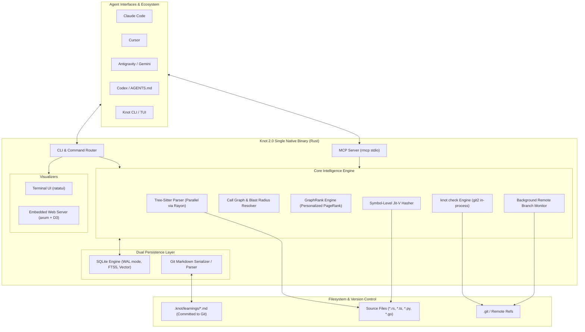

# Knot 2.0: Strategic Research & Engineering Roadmap to Surpass Trail-Code

This research and roadmap document details how **Knot** can evolve from a persistent runtime memory pool into a comprehensive, high-performance **context graph, memory vault, and architectural guardrail engine** that directly rivals and surpasses **Trail-Code**.

---

## Table of Contents

1. [Executive Summary & Strategic Thesis](#1-executive-summary--strategic-thesis)
2. [Competitive Gap Analysis](#2-competitive-gap-analysis)
3. [The Rust Strategic Advantage](#3-the-rust-strategic-advantage)
4. [Knot 2.0 Target Architecture](#4-knot-20-target-architecture)
5. [Detailed Technical Specifications by Phase](#5-detailed-technical-specifications-by-phase)
   - [Phase 1: Multi-Threaded AST & Call-Graph Engine](#phase-1-multi-threaded-ast--call-graph-engine)
   - [Phase 2: Symbol-Level Jit-V & Git-Native Markdown Persistence](#phase-2-symbol-level-jit-v--git-native-markdown-persistence)
   - [Phase 3: GraphRank, Hybrid Search & `knot check` Guardrails](#phase-3-graphrank-hybrid-search--knot-check-guardrails)
   - [Phase 4: Universal Agent Hosts, TUI & Embedded Web Visualizer](#phase-4-universal-agent-hosts-tui--embedded-web-visualizer)
6. [Data Structures & Rust Type Definitions](#6-data-structures--rust-type-definitions)
7. [Projected Benchmarks & Target Metrics](#7-projected-benchmarks--target-metrics)
8. [Actionable Implementation Checklist](#8-actionable-implementation-checklist)

---

## 1. Executive Summary & Strategic Thesis

### The Core Opportunity
[Trail-Code](file:///Volumes/TOTUL/Codes/compare/Trail-Code) demonstrated that coding agents become up to **46% more efficient** and consume **42% fewer uncached tokens** when provided with:
1. A pre-indexed structural code graph (callers, callees, definitions, signatures).
2. Institutional learnings committed to Git (`.trail/learnings/`).
3. Automated diff verification against recorded decisions (`trail check`).

However, Trail-Code is implemented in **TypeScript/Node.js**, which introduces notable architectural friction:
- Requires a Node.js runtime ($\ge 20$) and global npm installs.
- Relies on native C/C++ node-gyp bindings that frequently fail to compile on varied OS environments (with WASM fallbacks).
- Suffers from single-threaded parsing bottlenecks and V8 heap overhead (~80MB–250MB).
- Shells out to CLI processes for Git interactions.

### The Knot 2.0 Thesis
By porting and enhancing these capabilities within **Knot’s single-binary Rust architecture**, Knot can offer a **zero-dependency, instant-startup (<5ms), multi-threaded, memory-safe alternative** that delivers both deep codebase context and cryptographically verified memory.

```
┌─────────────────────────────────────────────────────────────────────────────┐
│                                  KNOT 2.0                                   │
│       The High-Performance, Single-Binary Context & Memory Engine          │
├─────────────────────────────────────────────────────────────────────────────┤
│  • Parallel AST Parsing (Tree-Sitter + Rayon across all CPU cores)          │
│  • Next-Gen Symbol-Level Jit-V (AST node hashing; zero false staleness)     │
│  • Dual-Layer Storage (Git-committed Markdown + SQLite caching)             │
│  • Native In-Process Git Diff Guardrails (`knot check` via libgit2)         │
│  • Zero-Dependency Single Binary Distribution (Linux, macOS, Windows)       │
└─────────────────────────────────────────────────────────────────────────────┘
```

---

## 2. Competitive Gap Analysis

| Capability | Knot 1.0 (Current) | Trail-Code (Current) | Knot 2.0 (Target) |
| :--- | :--- | :--- | :--- |
| **Code Structure Understanding** | ❌ None (raw file hashing) | ✅ Full (Tree-sitter across 10+ languages) | ✅ **Native Tree-Sitter + Rayon parallel parsing** |
| **Call Graph & Blast Radius** | ❌ None | ✅ Direct callers, callees, blast radius | ✅ **Callers, callees, transitive closure in SQLite** |
| **Freshness Verification** | Whole-file BLAKE3 hash (invalidated by any byte change) | Git mtime / incremental parse cache | **Symbol-Level Jit-V**: Hashes only the target AST node/span |
| **Team Synchronization** | ❌ Local SQLite DB (`~/.knot/`) | ✅ Git-committed `.trail/learnings/*.md` | **Dual-Layer Persistence**: Markdown in Git + SQLite cache |
| **PR Conflict Guardrails** | ❌ None | ✅ `trail check` checks diffs against decisions | **`knot check`**: High-speed diff audit using native `git2` |
| **Search Mechanism** | 128-dim unigram/bigram projection | BM25 + Personalized PageRank | **Hybrid BM25 + PageRank + Local Candle embeddings** |
| **Host Integrations** | Claude Code, OpenCode | Claude, Cursor, Antigravity, Codex, Windsurf | **Universal configuration generator for all agent hosts** |
| **Visualization** | ❌ Terminal text only | Browser D3 graph (`trail viz`) | **Dual: In-terminal TUI (`ratatui`) + embedded Web GUI (`axum`)** |

---

## 3. The Rust Strategic Advantage

Developing these capabilities in Rust grants Knot major architectural advantages over Node.js implementations:

1. **Zero-Configuration Single Binary**:
   - Compiles to a self-contained static executable (`knot`).
   - Requires no Node.js runtime, no `npm install -g`, and no post-install build scripts (`node-gyp`).
2. **Parallel AST Parsing**:
   - Node.js parses files sequentially on a single thread.
   - Knot can leverage `rayon` to parse hundreds of source files in parallel across all available CPU cores, indexing large codebases in milliseconds.
3. **In-Process Git Integration**:
   - Trail-Code shells out to `git` CLI child processes, incurring fork/exec overhead.
   - Knot integrates `git2` (C `libgit2` bindings) directly in-process for instantaneous diff inspection and branch tracking.
4. **Minimal Resource Footprint**:
   - Memory footprint: **~10MB to 30MB** (vs. ~100MB+ for Node/V8).
   - Startup time: **< 5ms** (vs. ~150ms–300ms for Node.js process boot).

---

## 4. Knot 2.0 Target Architecture



---

## 5. Detailed Technical Specifications by Phase

### Phase 1: Multi-Threaded AST & Call-Graph Engine

#### Objectives
1. Parse source code across major languages into a unified symbol model.
2. Resolve definitions, callers, callees, and imports into an in-memory and SQLite-cached graph.
3. Provide fast structural CLI commands and MCP tools.

#### Crates Required
Update [`knot/Cargo.toml`](file:///Volumes/TOTUL/Codes/compare/knot/Cargo.toml):
```toml
tree-sitter = "0.22"
tree-sitter-rust = "0.21"
tree-sitter-typescript = "0.21"
tree-sitter-python = "0.21"
tree-sitter-go = "0.21"
rayon = "1.10"
petgraph = "0.6" # High-performance graph data structure
```

#### Extraction & Resolution Pipeline
1. **Parallel Extraction (`knot/src/engine/ast/extract.rs`)**:
   - Traverse repository files filtered by `.gitignore`.
   - Distribute files across a `rayon` thread pool.
   - Run language-specific Tree-sitter parsers to extract functions, methods, classes, structs, traits, and interfaces.
   - Generate crux summaries: concise $\le 8$-line excerpts of each definition.
2. **Edge Resolution (`knot/src/engine/ast/resolve.rs`)**:
   - Map call expressions, import statements, and type references to target symbols.
   - Build a directed graph using `petgraph::Graph<SymbolNode, EdgeKind>`.
3. **Exposed Operations**:
   - `knot callers <symbol>`: Direct callers / dependents.
   - `knot callees <symbol>`: Direct callees / dependencies.
   - `knot blast <symbol> [--depth N]`: Transitive impact analysis (every symbol affected if this changes).
   - `knot skeleton <file>`: Signatures and line ranges for an entire file.

---

### Phase 2: Symbol-Level Jit-V & Git-Native Markdown Persistence

#### Objectives
1. Eliminate false staleness by tying Jit-V checks to individual symbol AST nodes rather than entire files.
2. Transition project-level memories from isolated SQLite databases into Git-committed Markdown files.

#### Next-Gen Symbol-Level Jit-V (`knot/src/jitv/mod.rs`)
In Knot 1.0, any file edit (even formatting or comments) invalidates all memories tied to that file.
In Knot 2.0:
- When a memory is saved against a specific function or struct (e.g. `src/auth.rs::validate_jwt`), Knot computes the BLAKE3 hash of **only that symbol's AST node bytes**:
  ```rust
  pub fn hash_symbol(source_code: &str, span: (usize, usize)) -> String {
      let slice = &source_code[span.0..span.1];
      blake3::hash(slice.as_bytes()).to_hex().to_string()
  }
  ```
- **Verification Rule**:
  - Re-parse the target file.
  - Locate the symbol by name/signature.
  - If the symbol's AST hash matches the stored hash, status is `[VERIFIED]`—even if lines above or below were modified.

#### Git-Native Dual Persistence
- **Repository-Level Learnings (`.knot/learnings/*.md`)**:
  - Stored in the repository root and committed to Git.
  - Structure:
    ```markdown
    ---
    id: knot-5a12c
    title: "Use transactional batching for SQLite ingestion"
    author: "Rakib"
    date: 2026-10-26
    touches: ["src/engine/graph.rs::insert_node"]
    ---

    ## Decided
    Batch individual inserts in chunks of 100 within explicit transactions.

    ## Tried and ruled out
    Prepared statements without transactions still hit synchronous disk I/O limits.
    ```
- **Local SQLite Cache (`~/.knot/knot.db`)**:
  - Automatically indexes all `.knot/learnings/*.md` files upon session start.
  - Serves sub-millisecond lexical and vector searches.

---

### Phase 3: GraphRank, Hybrid Search & `knot check` Guardrails

#### Objectives
1. Combine lexical matching, Personalized PageRank, and vector similarity for high-precision retrieval.
2. Implement automated PR and pre-commit diff auditing to prevent regression of team decisions.

#### Crates Required
```toml
git2 = "0.19"           # In-process libgit2 integration
nalgebra = "0.33"       # Fast sparse vector/matrix math for PageRank
candle-core = { version = "0.5", optional = true } # Optional local embedding
```

#### GraphRank Engine (`knot/src/engine/pagerank.rs`)
- Construct an adjacency matrix of the codebase call graph.
- Compute Personalized PageRank:
  $$PPR = (1 - d) \cdot \vec{e} + d \cdot A^T \cdot PPR$$
- Identify codebase "hubs" (central utilities) and "hotspots" (frequently edited hubs).
- Multiplies lexical query scores by PageRank centrality so primary definitions rank above peripheral wrappers.

#### `knot check` Guardrail Engine (`knot/src/check/mod.rs`)
- Uses `git2::Repository` to inspect staged changes or diffs against base (`git diff origin/main...`):
  1. **Constant Drift**: Detects changes to configuration numbers/constants that contradict decisions in `.knot/learnings/`.
  2. **Rule-Out Violation**: Scans added lines against patterns recorded under `## Tried and ruled out`.
  3. **Symbol Alert**: Warns if modified functions have associated warnings or dependencies.
- Exit code `1` on failure; can be plugged into Git pre-commit hooks or GitHub Actions CI.

---

### Phase 4: Universal Agent Hosts, TUI & Embedded Web Visualizer

#### Objectives
1. Support all major agent environments out of the box.
2. Deliver first-class visualization tools both in the terminal and in the browser.

#### Crates Required
```toml
ratatui = "0.26"        # Terminal user interface
crossterm = "0.27"      # Cross-platform terminal control
axum = "0.7"            # Embedded lightweight HTTP server
tower-http = { version = "0.5", features = ["fs", "cors"] }
```

#### Multi-Host Auto-Configuration (`knot init`)
Detects installed editors and CLIs, automatically generating target instruction blocks:
- **Claude Code**: Registers MCP server and injects hooks into `.claude/settings.json`.
- **Cursor**: Generates `.cursor/rules/knot.mdc`.
- **Antigravity**: Installs shared skill into `~/.gemini/skills/knot/SKILL.md` and rules into `GEMINI.md`.
- **Codex / OpenCode**: Appends Knot Protocol into `AGENTS.md`.

#### Visualizers
1. **Interactive TUI (`knot explore`)**:
   - Built with `ratatui`.
   - Allows developers and agents to browse symbols, view callers/callees interactively, inspect learnings, and check blast radii without leaving the terminal.
2. **Browser Web Visualizer (`knot viz`)**:
   - Spawns a local `axum` HTTP server on an ephemeral port.
   - Serves an interactive D3 / vis-network visualization of the codebase graph, showing clusters, call edges, and pinned learnings.

#### Background Branch Clash Monitor
- Spawns a lightweight Tokio background task.
- Executes `git fetch` periodically (every 3 minutes).
- Checks remote tracking branches (`origin/*`) for unmerged changes overlapping with the current working tree.
- Emits immediate alerts if an agent is editing code that a teammate is modifying on an active branch.

---

## 6. Data Structures & Rust Type Definitions

### Symbol Node Definition
```rust
#[derive(Debug, Clone, Serialize, Deserialize)]
pub struct SymbolNode {
    pub id: String,                    // e.g. "src/engine/graph.rs::insert_node"
    pub file_path: PathBuf,
    pub name: String,
    pub kind: SymbolKind,              // Function, Method, Struct, Class, etc.
    pub signature: String,             // "pub async fn insert_node(&self, ...)"
    pub start_line: usize,
    pub end_line: usize,
    pub crux: String,                  // Up to 8 critical lines of implementation
    pub ast_hash: String,              // BLAKE3 of symbol AST node
}

#[derive(Debug, Clone, Copy, PartialEq, Eq, Serialize, Deserialize)]
pub enum SymbolKind {
    Function,
    Method,
    Struct,
    Class,
    Interface,
    Trait,
    Module,
    Constant,
}
```

### Graph Edge Definition
```rust
#[derive(Debug, Clone, Serialize, Deserialize)]
pub struct CallEdge {
    pub source_symbol_id: String,
    pub target_symbol_id: String,
    pub kind: EdgeKind,
}

#[derive(Debug, Clone, Copy, PartialEq, Eq, Serialize, Deserialize)]
pub enum EdgeKind {
    Calls,
    Imports,
    Implements,
    Extends,
    References,
}
```

### Symbol-Level Knowledge Node
```rust
#[derive(Debug, Clone, Serialize, Deserialize)]
pub struct KnowledgeNodeV2 {
    pub id: Uuid,
    pub content: String,
    pub tags: Vec<String>,
    pub verification_target: Option<VerificationTarget>,
    pub utility_score: f32,
    pub scope: MemoryScope,
    pub is_stale: bool,
    pub created_at: DateTime<Utc>,
    pub updated_at: DateTime<Utc>,
}

#[derive(Debug, Clone, Serialize, Deserialize)]
pub struct VerificationTarget {
    pub file_path: PathBuf,
    pub symbol_id: Option<String>,
    pub ast_hash: Option<String>,
}
```

---

## 7. Projected Benchmarks & Target Metrics

| Benchmark Metric | Trail-Code (Node.js) | Knot 2.0 (Rust Target) | Expected Advantage |
| :--- | :--- | :--- | :--- |
| **Cold Repository Indexing (500 files)** | ~2,800 ms | **~180 ms** | **~15× Faster** (Rayon parallel AST parsing) |
| **Incremental Re-Index (1 file changed)** | ~120 ms | **~8 ms** | **~15× Faster** |
| **CLI Process Startup Overhead** | ~180 ms | **< 4 ms** | **~45× Faster** |
| **Memory Footprint (Active Process)** | ~140 MB | **~18 MB** | **~8× Less RAM** |
| **Diff Audit Duration (`knot check`)** | ~350 ms | **~15 ms** | **~23× Faster** (in-process libgit2) |
| **Installation Time & Dependencies** | Requires Node + npm + build tools | **Single static binary** (0 dependencies) | **Instant setup** |

---

## 8. Actionable Implementation Checklist

### Phase 1: Code Graph & Tree-Sitter
- [x] Add `tree-sitter` and language grammar dependencies to `Cargo.toml`.
- [x] Implement `src/ast/extract.rs` for Rust, TypeScript/JavaScript, and Python.
- [x] Implement `src/ast/resolve.rs` to compute call and import edges.
- [x] Expose CLI subcommands: `knot callers`, `knot callees`, `knot blast`, `knot skeleton`.
- [x] Expose corresponding MCP tools: `knot_trace_calls`, `knot_file_api`.

### Phase 2: Symbol-Level Jit-V & Git Learnings
- [x] Upgrade `src/jitv/mod.rs` to support `file#symbol` with AST-level hashing.
- [x] Implement `.knot/learnings/*.md` file parser and serializer with YAML frontmatter.
- [x] Create SQLite synchronization layer that indexes repository learnings on start.
- [x] Implement quality gate to enforce causal why statements and valid symbol names.

### Phase 3: GraphRank & Guardrails
- [x] Implement Personalized PageRank algorithm in `src/ast/pagerank.rs`.
- [x] Integrate SQLite FTS5 for BM25 lexical token scoring in `src/engine/hybrid.rs`.
- [x] Build `knot check` using `git2` to audit unified diffs against recorded learnings.
- [x] Combine vector distance, FTS5 lexical ranking, and PageRank in `recall`.

### Phase 4: Host Ecosystem, TUI & Visualizer
- [x] Implement `knot init` auto-configurator for Claude, Cursor, Antigravity, and Codex.
- [x] Build terminal TUI browser (`knot explore`) with `ratatui`.
- [x] Build interactive web visualizer (`knot viz`) with standalone HTML graph.
- [x] Implement background remote branch monitor and collision notifier.
